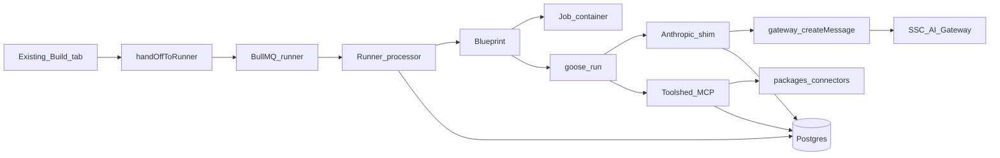

# Relay Runner

This is the spec for a real Runner. Relay stays the product: the same Build tab, roles, plan approval, question UI, and audit page. The worker behind that tab is what changes.

Design sources (not copied here):

- [Minions: Stripe's one-shot, end-to-end coding agents](https://stripe.dev/blog/minions-stripes-one-shot-end-to-end-coding-agents)
- [Minions, part 2](https://stripe.dev/blog/minions-stripes-one-shot-end-to-end-coding-agents-part-2)

Stripe did not publish the minion source. Those two posts are the closest public spec. The rules below are the parts Relay implements.

## Design rules

- One isolated workspace per job. The agent does not share a checkout, and it does not see production data or a person's credentials.
- The harness is [goose](https://github.com/aaif-goose/goose), run unattended. Relay owns the orchestration. goose is not forked. The job is not a goose recipe: a recipe is still one agent loop. A blueprint is Relay code that calls goose for some nodes and plain commands for others.
- A blueprint mixes fixed nodes (no model) with agent nodes (one headless goose run, fresh context, a small tool set).
- Feedback is shifted left. Lint and test run in the workspace before anything is treated as CI. Fix attempts are capped at 2. A third failure asks a person and stops.
- Connectors are one MCP server, Toolshed, built with the MCP TypeScript SDK. The Runner gets a read-only subset: search and get.
- Sandbox lifecycle and credential handling follow the shape used by [Open-Inspect](https://github.com/ColeMurray/background-agents): create, clone, setup, harness, destroy, and revoke credentials on failure. Relay does not copy its Cloudflare or Modal code, and it does not snapshot workspaces (a snapshot can keep a credential cache).
- Full permissions inside the workspace, no confirmation prompts, and no path to production.

## What stays

- UI: `src/components/runner-console.tsx`, `src/components/hand-off-modal.tsx`, and the Build tab. Same stages, same question and pull request presentation.
- Roles and gates: only the owner hands off, and only after an architect or lead has approved the plan (`src/lib/demo-store/permissions.ts`, `src/app/actions/ideas.ts`).
- Tables: `RunnerJob`, `AgentEvent`, `Question`, `Approval`, `AuditLog`. The console reads `AgentEvent`. Compliance rows go to `AuditLog`.
- Browser demo when `DATABASE_URL` is missing (`src/lib/db.ts`, `src/lib/demo-store/`). That path never starts Docker or goose.
- Scout and Planner stay as they are. Only the Runner job becomes real.

## Architecture



goose runs inside the job container. The worker supervises it with `docker exec`. The shell and file tools stay in the container so they cannot touch the worker filesystem.

Model path:

- goose `ANTHROPIC_HOST` is the worker shim, `POST /v1/messages`.
- The shim's only model client is `createMessage` in `packages/core/src/llm/gateway.ts`.
- `createMessage` is the only code that calls `AI_GATEWAY_BASE_URL`.
- The container receives a job token, not `AI_GATEWAY_API_KEY`.
- Mock mode (`RELAY_MODE=mock`, or no gateway key) never leaves the process. `createMessage` returns its deterministic stub. The default compose file stays in mock mode and does not mount the Docker socket. `docker-compose.live.yml` is the opt-in that sets `RELAY_MODE=live` and mounts the socket on the worker only.

Credential broker on the worker:

- Model: the shim checks the job token, then uses the real gateway key.
- Git: the clone token stays on the worker. The container's credential helper asks the broker for a short-lived token for that one repo. Nothing is baked into the image.
- Toolshed: HTTP MCP on the worker. goose uses `--with-streamable-http-extension`. Connector secrets stay on the worker.
- Job container egress is the shim, Toolshed, and the configured git remote.

Mock mode uses `FixtureSandbox` under `demo-repos/<jobId>` (tests use a temp directory). It does not spawn goose. Agent nodes call `createMessage` and write the same `AgentEvent` and `AuditLog` rows a live run would.

## Blueprint

`packages/core/src/runner/blueprint.ts` is pure enough to run without Docker. Nodes:

1. `clone` (fixed). Empty workspace, then checkout of the configured fixture or sandbox repo. Never a production remote by default.
2. `install` (fixed). `pnpm install`. A non-zero exit fails the job.
3. `plan` (agent). Fresh goose run over the approved plan text plus hand-off context. The note is stored as `thought_summary`. `Plan.status` does not change.
4. `edit` (agent). Fresh goose run. It may edit files and call Toolshed. The prompt includes the approved plan and the plan note.
5. `lint` (fixed). No model.
6. `test` (fixed). No model. Skipped when lint already failed, so the fix prompt sees the first failure.
7. On failure, `fix` (agent), then `lint` and `test` again. Attempt 1.
8. On failure, `fix`, then `lint` and `test` again. Attempt 2.
9. On failure, stop. Insert a `Question`, set `RunnerJob.status` to `awaiting_input` and the workstream stage to `awaiting_input`. Do not start a third fix.
10. On success, record `branch` and set `prUrl` to `sandbox://jobs/<id>` so the existing console can show the pull request. Do not open a GitHub pull request. Status `succeeded`, workstream stage `pr_open`. Merge stays the existing human action.

`paused_budget` is unused. `failed` is for infrastructure errors (container, clone, or install), not for a red test suite.

`nextFixDecision(fixesAlreadyRun)` returns `ask` once two fixes have run. `assertFixAllowed` throws if a caller tries to start a third.

goose invocation, one process per agent node, inside the container:

```bash
goose run --no-session --no-profile --provider anthropic --model "$MODEL" \
  --max-turns 30 --output-format stream-json \
  --with-builtin developer \
  --with-streamable-http-extension "$TOOLSHED_URL" \
  -t "$PROMPT"
```

Environment for that exec: `ANTHROPIC_HOST` (the shim), `ANTHROPIC_API_KEY` (the job token), `GOOSE_PROVIDER=anthropic`. `AI_GATEWAY_API_KEY` and `GITHUB_TOKEN` are not copied in. `--output-format stream-json` lines become `AgentEvent` rows.

Stream subset the parser accepts, one JSON object per line:

- `{"type":"text","text":"..."}` becomes `thought_summary`
- `{"type":"tool_call","name":"...","arguments":{}}` becomes `tool_call`
- `{"type":"tool_result","name":"...","result":"..."}` becomes `tool_result`
- `{"type":"file_edit","path":"..."}` becomes `file_edit`

## Audit

Every model call, tool call, and approval writes the existing `AuditLog` table. `model_call` and `approval` already exist. `tool_call` is a new enum value so lint, test, git, and MCP calls are not stored as `connector_access`. Connector tools also fill `connectorItemsAccessed`. `hand_off` is written when the job is enqueued. `AgentEvent` rows still feed the console.

The shim writes `model_call` with token counts from `createMessage`. Toolshed and fixed nodes write `tool_call`. `writeAudit({ action: "approval" })` is how a stored approval is recorded. The demo-store audit is unchanged.

## Files

Added:

- `PLAN.md` (this file)
- `packages/core/src/runner/blueprint.ts` and `blueprint.test.ts`
- `packages/core/src/audit.ts` and `audit.test.ts`
- `packages/core/src/llm/anthropic-shim.ts` and `anthropic-shim.test.ts`
- `packages/core/src/runner/hand-off.ts` and `hand-off.test.ts`
- `packages/connectors/src/toolshed/server.ts` and `server.test.ts`
- `apps/worker/src/queue.ts`
- `apps/worker/src/runner/processor.ts` and `processor.test.ts`
- `apps/worker/src/runner/sandbox.ts` and `sandbox.test.ts`
- `apps/worker/src/runner/goose.ts` and `goose.test.ts`
- `apps/worker/src/runner/broker.ts`
- `apps/worker/src/runner/prisma-store.ts`
- `docker/Dockerfile.runner` (Node, pnpm, git, goose CLI, no secrets)
- `docker-compose.live.yml`
- `scripts/run-runner-sandbox.sh` (one container when Docker and goose are present; exits cleanly when they are not)
- Prisma migration adding `AuditAction.tool_call`

Changed:

- `apps/worker/src/index.ts` starts the BullMQ consumer, the shim, and Toolshed. The heartbeat stays.
- `src/app/actions/ideas.ts` creates the row, writes `hand_off`, and enqueues one job. The processor checks the approved plan again before it opens a workspace.
- Workstream detail loads `AgentEvent` rows over SSE into the existing console. No new screen.
- `docs/architecture.md` points the Runner paragraph at this file.
- `.env.example` lists the shim port, Toolshed port, and workspace root.

## Milestones and tests

Vitest, via `pnpm test`. Live Docker and a real goose binary are not required. CI uses the fakes.

1. Blueprint (`packages/core/src/runner/blueprint.test.ts`). A green lint and test run visits plan and edit and never visits fix. A red suite runs fix twice and returns `awaiting_input`. A third fix is impossible.
2. Audit helper (`packages/core/src/audit.test.ts`). Writes `model_call`, `tool_call`, and `approval`, then reads them back in the `AuditLog` shape.
3. Shim (`packages/core/src/llm/anthropic-shim.test.ts`). An Anthropic `/v1/messages` body hits `createMessage` and not a provider host. Mock mode returns the stub plus an audit row. A bad job token is rejected.
4. Toolshed (`packages/connectors/src/toolshed/server.test.ts`). Lists only `knowledge_search` and `knowledge_get`, searches the mock corpus, and records `tool_call` with the items accessed. No write tool exists.
5. Sandbox port (`apps/worker/src/runner/sandbox.test.ts`). A fake Docker client: one container per job, phases create then clone then install then destroy, token revoked on destroy and on boot failure. Mock mode selects `FixtureSandbox` and never calls the client.
6. Goose adapter (`apps/worker/src/runner/goose.test.ts`). Argv uses provider anthropic, the shim host, builtin developer, and the Toolshed URL. The environment has no gateway key. A fixture stream maps to `AgentEvent` types.
7. Processor, mock mode (`apps/worker/src/runner/processor.test.ts`). Statuses move `queued` to `provisioning` to `running` to `succeeded`. Events and audit rows exist. goose is not spawned.
8. Two-strike stop (same file). A fixture whose test command fails: two fix attempts, one `Question`, status `awaiting_input`. goose spawn count is the plan, edit, and two fix nodes only.
9. Hand-off enqueue (`packages/core/src/runner/hand-off.test.ts`). The hand-off creates the row, writes `hand_off`, and adds one job. A viewer or an unapproved plan throws, and no job is added.
10. Demo regression. The existing demo-store "merged pull request" test and the Playwright happy path stay green with no database and no gateway key.
