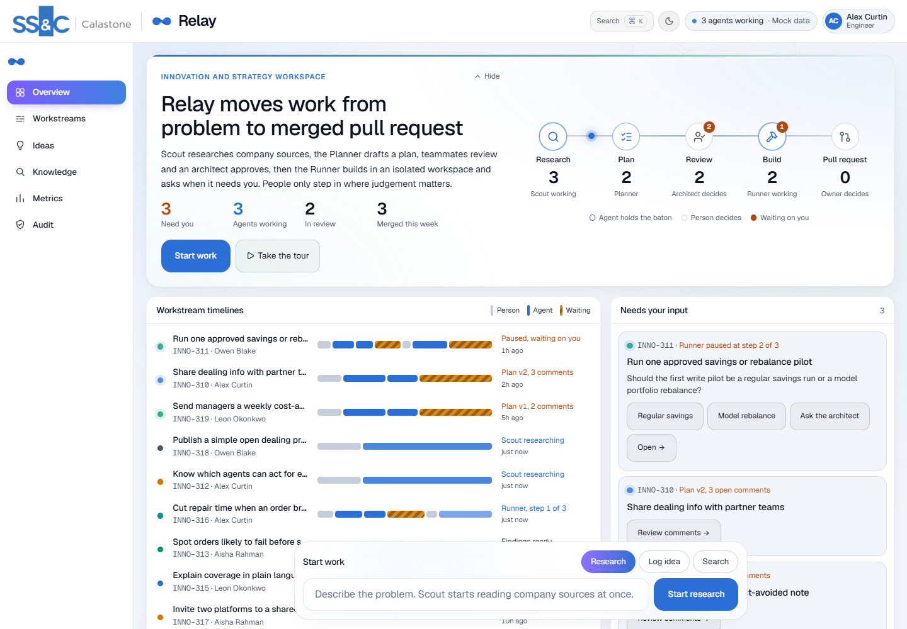
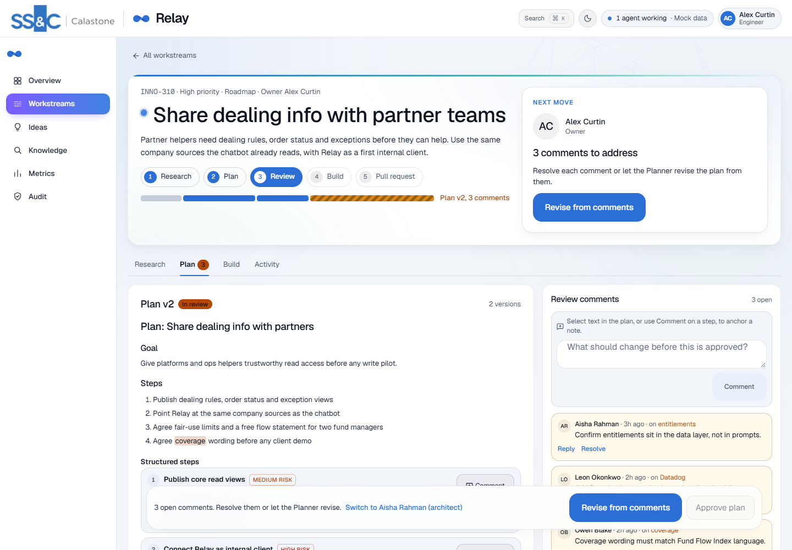
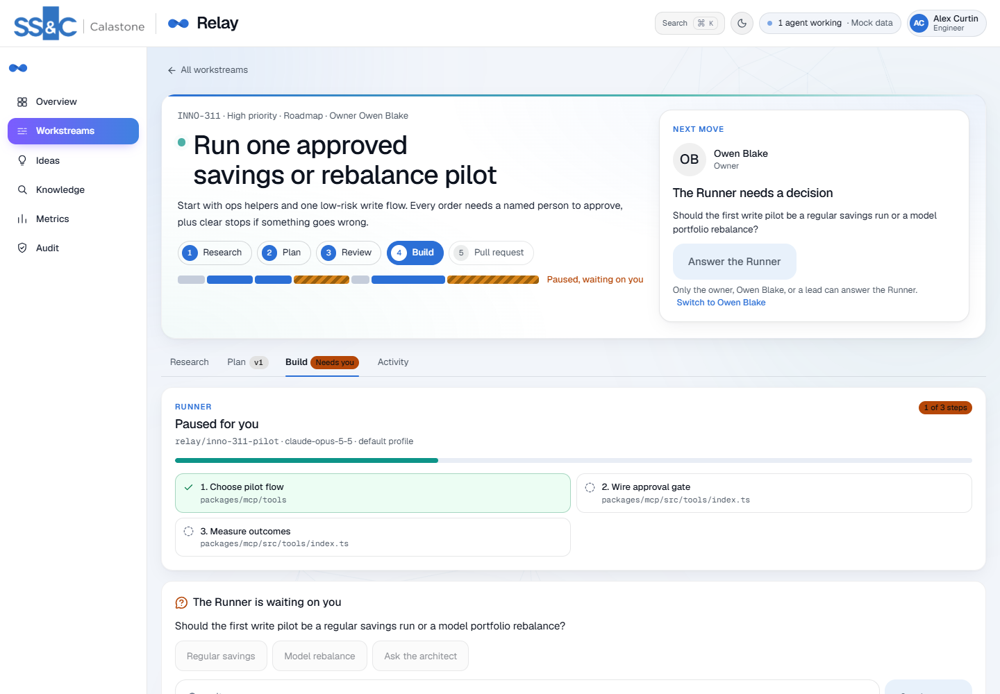
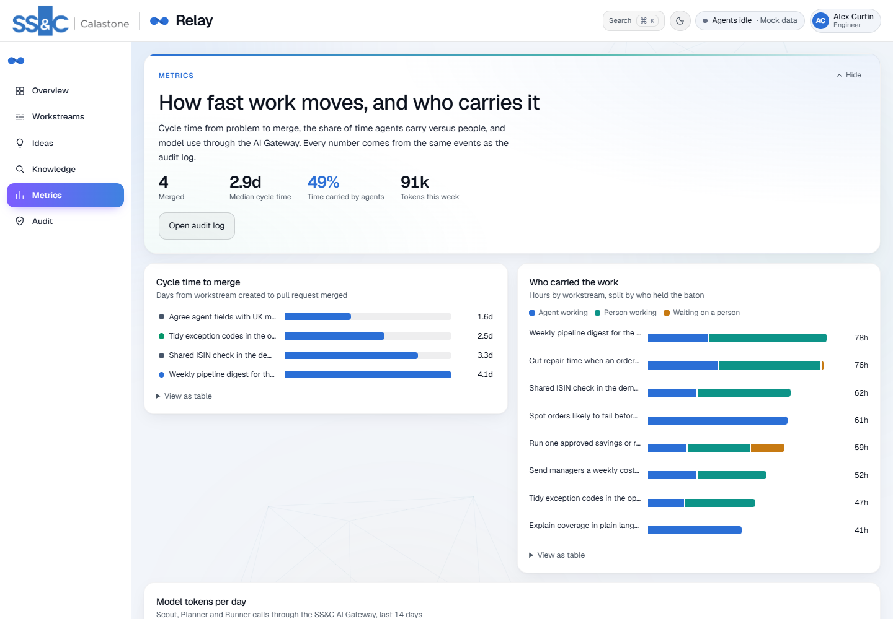
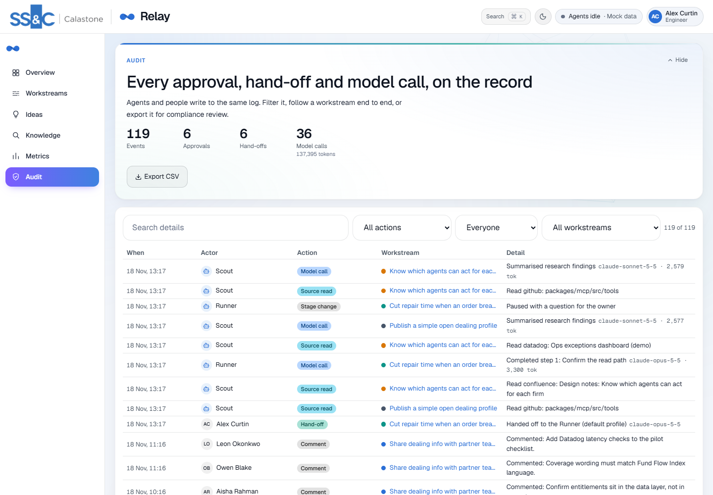

# Relay

White-labelled internal agent workspace for Calastone Innovation and Strategy. Prototype modelled on Stripe Orbit: Scout researches company sources, the Planner drafts a plan, teammates review and an architect approves, the Runner builds in an isolated workspace and asks when it needs you, and everything is tracked on one dashboard.



## Try it in two minutes

1. Run it (below) or open the Vercel deployment.
2. On the Overview, select **Take the tour**. The coach card walks one problem all the way to a merged pull request, switching between the owner and the architect as needed. Each step has a "Do it for me" button.

## Demo mode (no database)

When `DATABASE_URL` is empty (the Vercel case) or `RELAY_DEMO_FIXTURES=1`, Relay runs entirely in the browser:

- Every action works: create workstreams, ask Scout, generate and revise plans, comment, resolve, approve, hand off, answer the Runner, merge, triage and promote ideas.
- Scout, the Planner and the Runner are simulated from stored timestamps, so they keep moving and a reload picks up where they were.
- Planner calls still go through the LLM gateway (`draftPlan` server action); in mock mode a deterministic template supplies the plan.
- State lives in `localStorage` under `relay.demo.v1` in this browser only. Use the user menu (top right) to switch roles, change agent speed, or **Reset demo data**.
- Add `?speed=20` to any URL to run agents twenty times faster.

The store is in `src/lib/demo-store/` (reducer, permissions, selectors, simulation, seed).

## Quick start (Docker, with Postgres)

Requires Docker Desktop.

```bash
cp .env.example .env
docker compose up --build
```

Open [http://localhost:3000](http://localhost:3000).

## Local development

```bash
pnpm install
pnpm dev            # demo mode when DATABASE_URL is empty
```

With Postgres:

```bash
# Start Postgres and Redis (for example: docker compose up postgres redis)
cp .env.example .env
pnpm db:migrate:dev
pnpm db:seed
pnpm dev
```

## What works now

- Story-led pages: every page opens with a compact hero (purpose, live numbers, next move) that collapses to a strip
- Overview with the relay pipeline (five legs, live counts, who holds the baton), actionable "Needs your input" cards and a Start work composer
- Workstream detail with a stage hero and **Next move** card, plus Research, Plan, Build and Activity tabs
- Anchored review: select plan text or use a step's Comment button, reply, resolve, revise into a new version
- Role-gated actions with the reason shown and a "Switch to" shortcut for presenters
- Runner console: step checklist, live log, question card, pull request with checks and merge
- Ideas board (New, Triaged, Promoted, Parked) with promotion into workstreams
- Metrics: cycle time, who carried the work (agent, person, waiting), tokens per day
- Audit: every approval, hand-off, answer and model call, filterable, with CSV export
- Knowledge search across Salesforce, Power BI, Jira, Confluence, Databricks, Datadog and GitHub (mock corpus)
- Astryx (Meta's design system) for dialogs, tabs, tables, badges, avatars, menus and empty states, themed with Calastone tokens

## Not yet

- Real Scout, Planner and Runner job processors in the worker, and SSE (database mode shows records but agents do not run)
- Database-mode server actions for comments, approval and answers (they work in demo mode)

## Testing

```bash
pnpm test                                   # unit tests, including the demo store journey
PW_CHANNEL=msedge pnpm exec playwright test # browser happy path (use chrome or omit as available)
```

## Screenshots

| | |
|---|---|
|  |  |
|  |  |

Earlier milestones: `docs/screenshots/before-*.png` and `after-*.png`.

## Branding

- Logos: SS&C Calastone `logo-header.png` / `logo-on-dark.png`; Relay `relay.svg` / `relay-mark.svg`
- Tokens: `src/app/globals.css` (light first, dark via toggle, Calastone blues). Astryx components read the same tokens through `src/app/astryx-theme.css`.

## Config

See `.env.example`. All model calls go through `packages/core/src/llm/gateway.ts`.

## Docs

- [CLAUDE.md](./CLAUDE.md)
- [Architecture](./docs/architecture.md)
- [Security](./docs/security.md)
