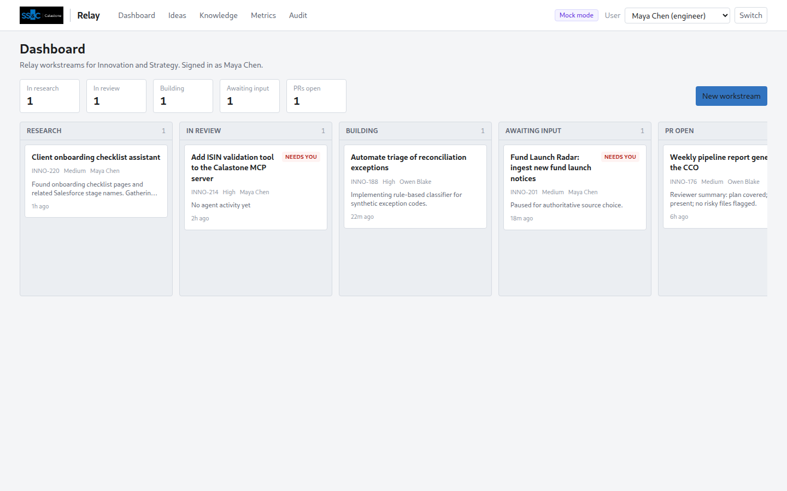
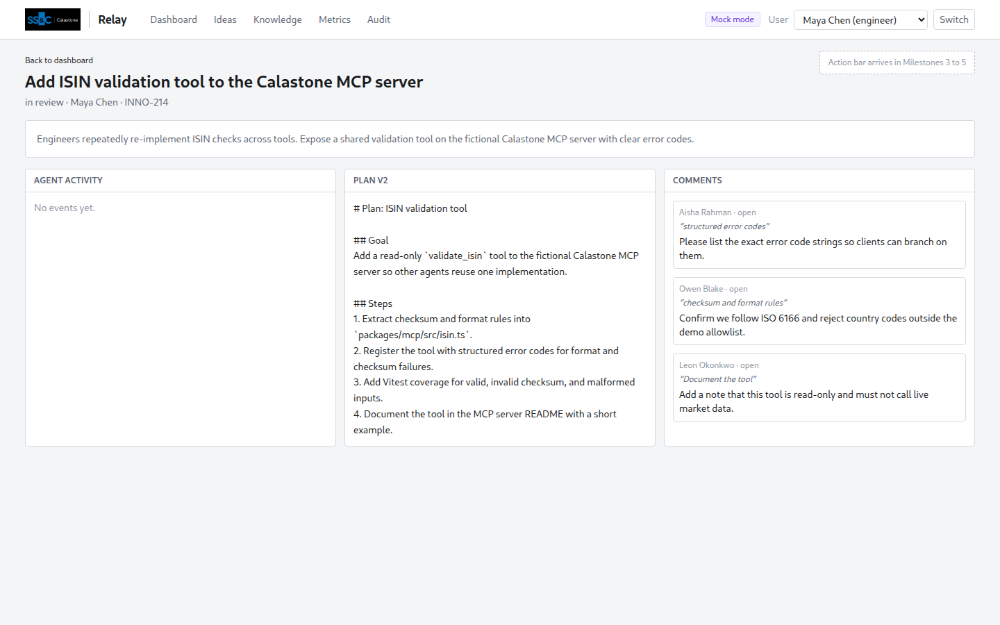
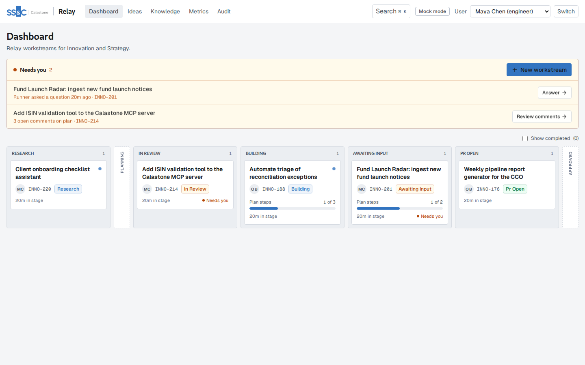
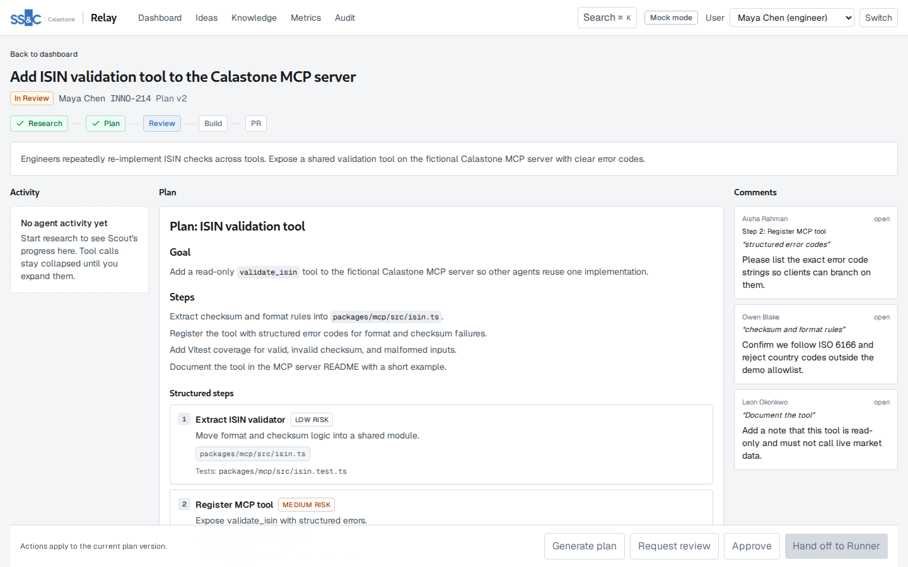

# Relay

White-labelled internal agent workspace for Calastone Innovation and Strategy. Prototype modelled on Stripe Orbit: research, plan, review, hand off to an isolated Runner, and track everything on one dashboard.

**Milestone 1 (skeleton) is implemented:** monorepo, Docker Compose, Prisma schema, demo seed, branded app shell, dashboard reading seeded workstreams.

## Quick start (Docker)

Requires Docker Desktop.

```bash
cp .env.example .env
docker compose up --build
```

Open [http://localhost:3000](http://localhost:3000).

You should see five seeded workstreams, a Mock mode badge, and a user switcher in the header.

## Local development without full Compose

```bash
pnpm install
# Start Postgres and Redis (for example: docker compose up postgres redis)
cp .env.example .env
pnpm db:migrate:dev
pnpm db:seed
pnpm dev
```

## What works now

- Branded header with SS&C Calastone logo PNGs and `APP_NAME`
- Mock mode badge and role switcher (engineer / architect / lead / viewer)
- Dashboard board grouped by stage with counts and Needs you markers
- Workstream detail stub showing seeded plan, comments, and agent events
- New workstream form (creates a DB record)
- Worker heartbeat process
- Full Prisma domain model and story seed

## Not yet

- Live connectors and knowledge search (Milestone 2)
- Scout / Planner agents and SSE (Milestone 3)
- Anchored review workflow (Milestone 4)
- Runner worktrees and ask_human (Milestone 5)
- Ideas / Metrics / Audit screens (Milestone 6)
- Playwright happy path (Milestone 7)

## Screenshots

### Before (Milestone 1 shell)





### After (Operate redesign)






## Branding

- Logos: `public/brand/logo-light.png` (header), `logo-dark.png` / `logo-on-dark.png` for dark surfaces, plus `logo.svg` placeholder
- Theme tokens: `theme/brand.ts` (primary blue `#3274C0` sampled from the provided SS&C logo PNG; other neutrals are placeholders)


## Config

See `.env.example`. All model calls go through `packages/core/src/llm/gateway.ts`.

## Docs

- [CLAUDE.md](./CLAUDE.md)
- [Architecture](./docs/architecture.md)
- [Security](./docs/security.md)
