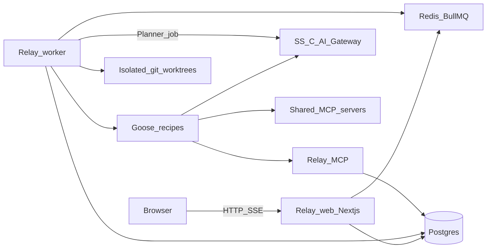

# Architecture

Relay is a monorepo prototype. Engineers move work from problem to pull request inside one workspace. Relay owns the dashboard, plans, comments, approvals and the Needs you list. Agent work runs through Goose recipes and shared MCP servers; every model call still goes through the SS&C AI Gateway module.

## Components

- **Web**: dashboard, workstream detail, knowledge search. Reads Postgres. Subscribes to agent activity over SSE. Ideas, metrics and audit land in Phase 7.
- **Worker**: consumes `research`, `plan`, and `runner` jobs from BullMQ.
- **Goose**: Scout (read-only MCP) and Runner (sandbox writes) recipes. Points at the gateway via Anthropic-compatible host settings. Does not call providers directly.
- **Planner**: one structured gateway call (findings in, JSON plan out). No agent loop.
- **Gateway module**: `packages/core/src/llm/gateway.ts` is the only outbound model transport for Relay-owned calls. Goose must also target the same gateway host and key.
- **Shared MCP**: single `mcp-servers.yaml` (same config as LibreChat) for Atlassian, Databricks/contracts, Salesforce, Power BI, GitHub. Tools marked `read` or `write`.
- **Relay MCP**: `ask_human`, `report_progress`, `record_finding`, `finish` for human-in-the-loop and progress into Postgres.
- **Connectors**: thin adapters over MCP for knowledge search; mock corpus remains for `RELAY_MODE=mock`.
- **Isolated workspaces**: one git worktree per Runner job (Docker sandbox in live builds; `demo-repos/` in mock / spike).

## Config

See `.env.example`. Critical keys: `APP_NAME`, `RELAY_MODE`, `MODEL_ID`, `AI_GATEWAY_BASE_URL`, `AI_GATEWAY_API_KEY`, `DATABASE_URL`, `REDIS_URL`, `TOKEN_BUDGET_PER_JOB`, `JOB_TIMEOUT_MS`.

Implementation phases and redesign rules: `docs/plan/RELAY_PLAN.md`.
