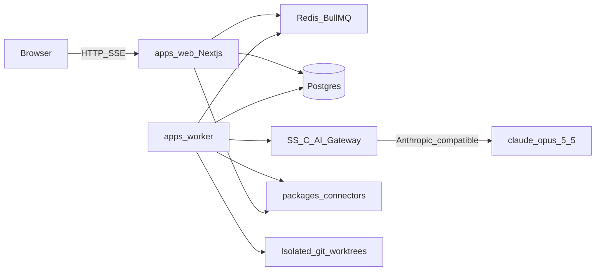

# Architecture

Relay is a monorepo prototype. Engineers move work from problem to pull request inside one workspace, with research, planning, review, and isolated build agents.

## Components

- **Web**: dashboard, workstream detail, ideas, knowledge chat, metrics, audit. Runs Scout/Planner/Runner mock progression in-process and streams activity over SSE. Plan review and ask_human answers write through server actions. Demo fixtures use in-memory agent/review/runner stores when `useDemoFixtures()` is on.
- **Worker**: heartbeat today; mock Runner currently progresses from the web process after hand-off. BullMQ consumers can replace that path later.
- **Agents**: `packages/agents` (Scout + Planner). Runner script lives under `src/lib/runner`. Every model call goes through the gateway.
- **Mock workspaces**: `demo-repos/ops-tools` for Runner file-edit paths in mock mode.
- **Gateway module**: `packages/core/src/llm/gateway.ts` is the only outbound model transport.
- **Connectors**: MCP-style read interfaces under `packages/connectors`, package name intent `relay-toolshed`.
- **Isolated workspaces**: one git worktree per Runner job (Docker in live/local builds; `demo-repos/` in mock mode).

## Config

See `.env.example`. Critical keys: `APP_NAME`, `RELAY_MODE`, `MODEL_ID`, `AI_GATEWAY_BASE_URL`, `AI_GATEWAY_API_KEY`, `DATABASE_URL`, `REDIS_URL`.
