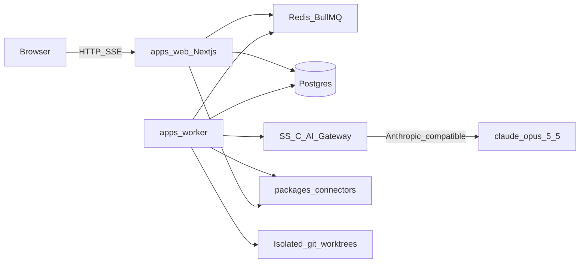

# Architecture

Relay is a monorepo prototype. Engineers move work from problem to pull request inside one workspace, with research, planning, review, and isolated build agents.

## Components

- **Web**: dashboard, workstream detail, ideas, knowledge, metrics, audit. Reads Postgres. Subscribes to agent activity over SSE (from Milestone 3).
- **Worker**: consumes runner jobs from BullMQ. The Runner blueprint, sandbox, and goose adapter are specified in [PLAN.md](../PLAN.md). Research and plan processors are still pending.
- **Gateway module**: `packages/core/src/llm/gateway.ts` is the only outbound model transport. goose talks to the worker shim, and the shim calls this module.
- **Connectors**: read interfaces under `packages/connectors`. Toolshed (`packages/connectors/src/toolshed/server.ts`) exposes them as one MCP server.
- **Isolated workspaces**: one workspace per Runner job (Docker when `RELAY_MODE=live`; `demo-repos/` in mock mode). See [PLAN.md](../PLAN.md).

## Config

See `.env.example`. Critical keys: `APP_NAME`, `RELAY_MODE`, `MODEL_ID`, `AI_GATEWAY_BASE_URL`, `AI_GATEWAY_API_KEY`, `DATABASE_URL`, `REDIS_URL`.
